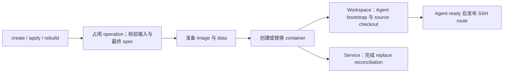

# Codespace

## Core Intent

以声明式配置管理个人开发环境，让实例可创建、重建、连接和清理，同时将持久数据与运行
环境分离。macOS 是唯一 client，Linux 是唯一受管 remote Host；本机控制面通过 OpenSSH
管理 Host 上的 rootful Podman。

- **Project** 是配置蓝图；**Workspace** 是其在指定 Host 上的命名实例，拥有持久数据、
  SSH 入口和可选 repository checkout。
- **Service** 是 Host 级单例，由配置声明 image、placement 和 container inputs。
- **WSL** 从 Workspace filesystem 派生本地 distribution，不属于受管 Host。

## Context Index

按任务加载；下层 `AGENTS.md` 继承本文件，只补充自身职责和约束。

| 任务 | 先读 | 联动上下文 |
| --- | --- | --- |
| 控制面、Web、Runtime、Maintenance 或 CLI | [Control Plane](src/codespace/AGENTS.md) | Agent 协议变化读 [Workspace Agent](platform/container/workspace/agent/AGENTS.md) |
| Workspace image、Resource、rootfs 或 s6 | [Workspace Image](platform/container/workspace/AGENTS.md) | 对应 Agent 或 tool 的下层文档 |
| Service image | [Service Images](platform/container/services/AGENTS.md) | 共享 s6 变化同时读 Workspace 文档 |
| ASR | [ASR](platform/container/services/asr/AGENTS.md) | 部署读 [Deployment](platform/container/services/asr/deployment/AGENTS.md)；语料和评分读 [Regression](platform/container/services/asr/regression/AGENTS.md) |
| Framework image | [Framework Images](platform/container/frameworks/AGENTS.md) | 对应 combo 的 Dockerfile 与 build script |
| macOS 环境、dotfiles 或 client SSH | [macOS Platform](platform/macos/AGENTS.md) | 共享 home 变化同时读 Workspace 文档 |
| WSL build、boot 或 Windows wiring | [WSL Platform](platform/wsl/AGENTS.md) | 继承的 filesystem/s6 变化同时读 Workspace 文档 |
| Codex LLMBox | [Codex LLMBox](platform/container/workspace/tools/codex-llmbox/AGENTS.md) | rootfs profile 与 custom-job 的边界见 Workspace 文档 |

## Key Contracts

- 配置表达 desired state，Podman labels 与 inspect 表达 actual state；不以当前配置补齐
  已部署 metadata，不自动迁移过时资源。
- 依赖方向是 `web -> control -> workspaces/services -> runtime`。Web 不拥有业务状态，
  runtime 不读取应用配置，container artifact 不包含控制面逻辑。
- 同类资源写操作共用 identity、互斥和错误记录：先校验输入、ownership、凭据与最终 spec，
  再准备 image/data，最后修改资源。失败保留现场，不伪装成功或自动 rollback。
- 异步子任务属于发起它的请求或操作；失败/取消先终止并等待关联任务，再清理文件。
  线程不会随协程取消而停止，仍使用文件的线程必须完成后才能释放文件。
- 自管 archive 安装先校验 checksum，在 staging 解包并检查 layout/executable，再发布与
  EXIT 清理。准备失败不破坏现有安装；原生 package manager 使用自身维护机制。
- 只抽取语义相同且有明确 owner 的基础能力，不因外观相似合并独立业务算法；不增加
  `common`、`utils`、compatibility package、fallback 或迁移层。
- 当前用户目录用 `$HOME`、`~` 或 home API；固定用户 `x` 的初始化、rootfs、跨 stage COPY
  和 mount 合同用固定绝对路径。不用带用户名的 tilde 或额外账户查询；应用路径展开须确认
  原生支持，不增加模板替换或 Shell wrapper。
- 自管 SDK/runtime 与语言 CLI 放在 `$HOME/.local/opt`，macOS 与 Workspace 相对布局一致；
  应用数据、cache 与 package manager 保持原生布局。
- 不修改无关用户、工作树或远端状态；真实 token、secret 与机器配置不得提交。

### Documentation

- 根文档维护共享约定、跨模块边界与上下文索引；模块用 `Scope` 说明职责，按需依次补充
  `Context Index`、`Contracts`、`Architecture`、`Main Flows`、`Runtime I/O`、`Pitfalls`、
  `Validation`，不重复继承规则。本项目不新增 `DESIGN.md` 或 `README.md`；全局 AI 规则
  模板按用途组织。
- 普通 case 遵从“代码即配置，现状即约定”。schema、manifest、代码、测试与
  [Taskfile.yaml](Taskfile.yaml) 拥有可变细节；引用路径定位，不复制版本、端口、目录树、
  完整清单或逐步实现，不把偶然实现固化成约束。实现与核心约束冲突时先指出差异。
- 职责、关键约束、主链路或重要副作用变化时同步最近的文档；陷阱写明触发条件、影响与
  处理方式，限制解除后删除。重写保留或明确迁移有效约束，测试不能代替约束原因。
- 不记录改造计划；测量与基线保存为带日期和口径的数据产物，历史结果不代表当前验证。
  注释只解释代码无法表达的约束或外部兼容原因。Shell 使用 `#!/usr/bin/env bash`。

## Main Flows

[CLI](src/codespace/cli.py) 启动本机 Web，
[ControlPlane](src/codespace/control.py) 编排 domain 与 runtime。部署关键链路如下，
具体分支由 [Workspace lifecycle](src/codespace/workspaces/lifecycle.py) 与
[Service domain](src/codespace/services.py) 拥有。

Workspace 的 provider source 须先注册 deploy key 再放行 checkout；rebuild 复用持久数据，
但重新执行授权与 bootstrap。维护命令先 discovery 并输出完整 plan，显式 apply 才修改业务
资源；删除与清理依赖已部署 metadata 和 ownership，不把缺少凭据解释成资源不存在。

平台目录独立构建 artifact：Workspace 提供基础 filesystem、runtime、Agent 与静态 s6，
Resource 提供可选工具，Service/Framework 拥有各自环境；WSL 继承 filesystem 后叠加本地
boot 合同，不在控制面重复实现。

## Runtime I/O

控制面读取本机配置与 OpenSSH 设置，写入动态 SSH route；通过 SSH/Podman 读写 Host 的
container、secret、volume 与受管持久数据，并通过 GitHub/GitLab API 管理 deploy key。
普通 remove 保留 data，purge/prune 才删除；详细范围与失败状态由
[Control Plane](src/codespace/AGENTS.md) 拥有。

[macOS maintenance](platform/macos/AGENTS.md) 会安装或清理声明的软件、替换声明的 home
目标，并按显式操作改变 LaunchAgent 或默认应用；它不是只读环境检查。专用 CLI、ASR
工具和 WSL 的读写、网络及系统配置边界见各自文档，根文档不重复维护文件清单。

## Validation

- 文档或非行为变更运行 `task check`；行为变更运行 `task check:full`。具体检查范围见
  [Taskfile.yaml](Taskfile.yaml)。小风险改动只做相关必要检查，不要求无关测试或完整构建。
- 各 Go module 的 golangci-lint 共用系统临时目录中的进程锁；并行检查等待锁后串行执行，
  避免超过工具默认锁等待窗口。
- 用户明确排除某模块验证时执行其余检查并报告范围，不运行包含该模块的聚合任务。
- artifact 行为变化另按所属文档构建、export 或做平台验证；通用检查不能替代 artifact
  验证。容器环境构建和运行使用 `/opt/podman/bin/podman`，context 为 repository root。
