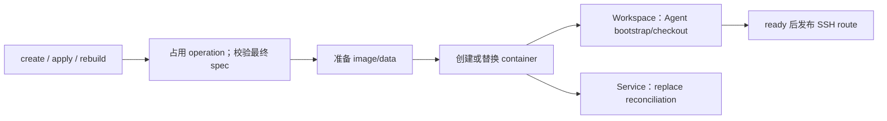

# Codespace

## Core Intent

以声明式配置管理个人开发环境，将持久数据与可重建的运行环境分离。macOS 是唯一 client，
Linux 是唯一受管 remote Host；本机控制面通过 OpenSSH 管理 Host 上的 rootful Podman。

- **Project** 是配置蓝图；**Workspace** 是指定 Host 上的命名实例，拥有持久数据、SSH
  入口和可选 repository checkout。
- **Service** 是 Host 级单例，配置声明 image、placement 和 container inputs。
- **WSL** 从 Workspace filesystem 派生本地 distribution，不属于受管 Host。

## Context Index

按任务加载；下层 `AGENTS.md` 继承本文件，只补充局部职责与约束。

| 任务 | 先读 | 联动上下文 |
| --- | --- | --- |
| 控制面、Web、Runtime、Maintenance 或 CLI | [Control Plane](src/codespace/AGENTS.md) | 协议变化读 [Workspace Agent](platform/container/workspace/agent/AGENTS.md) |
| Workspace image、Resource、rootfs 或 s6 | [Workspace Image](platform/container/workspace/AGENTS.md) | 对应 Agent/tool 的下层文档 |
| Service image | [Service Images](platform/container/services/AGENTS.md) | 共享 s6 变化同时读 Workspace 文档 |
| ASR | [ASR](platform/container/services/asr/AGENTS.md) | 部署读 [Deployment](platform/container/services/asr/deployment/AGENTS.md)；语料与评分读 [Regression](platform/container/services/asr/regression/AGENTS.md) |
| Framework image | [Framework Images](platform/container/frameworks/AGENTS.md) | 对应 combo 的 Dockerfile/build script |
| macOS 环境、dotfiles 或 client SSH | [macOS Platform](platform/macos/AGENTS.md) | 共享 home 变化同时读 Workspace 文档 |
| WSL build、boot 或 Windows wiring | [WSL Platform](platform/wsl/AGENTS.md) | filesystem/s6 变化同时读 Workspace 文档 |
| Codex LLMBox | [Codex LLMBox](platform/container/workspace/tools/codex-llmbox/AGENTS.md) | rootfs/custom-job 由 Workspace 文档说明 |

## Key Contracts

- 配置表达 desired state，Podman labels/inspect 表达 actual state；不以当前配置补齐
  已部署 metadata，不自动迁移过时资源。
- 依赖方向为 `web -> control -> workspaces/services -> runtime`；Web 不拥有业务状态，
  runtime 不读取应用配置，container artifact 不包含控制面逻辑。
- 同类资源写操作共用 identity、互斥与错误记录；副作用前校验输入、ownership、凭据与最终
  spec。失败保留现场，不伪装成功或自动 rollback。
- 异步子任务属于发起它们的请求/操作；失败或取消时先终止并等待全部关联任务，再清理
  文件。线程不随包装协程取消而停止，必须等待其完成才能释放文件或容量。
- 自管 archive 安装先校验 checksum、staging 解包和 layout/executable，再发布与 EXIT
  清理；准备失败保留已有安装。原生 package manager 使用自身维护机制。
- 只抽取语义相同且有明确 owner 的能力，不因外观相似合并业务算法；不增加 `common`、
  `utils`、compatibility package、fallback 或迁移层。
- 当前用户路径用 `$HOME`、`~` 或 home API；固定用户 `x` 的初始化、rootfs、跨 stage COPY
  和 mount 合同用绝对路径，不用带用户名的 tilde 或额外账户查询。应用路径展开须确认原生
  支持，不增加模板替换或 Shell wrapper。
- 自管 SDK/runtime 与语言 CLI 放在 `$HOME/.local/opt`，macOS/Workspace 相对布局一致；
  可移植 Node/Python CLI 与默认 runtime、binding、profile、editor 路径同步，Linux-only
  CLI 独立声明。Rust SDK 精确锁定，不用浮动 channel；用户数据/cache/manager 保持原生布局。
- 通用 AI 工作手册以 Workspace home rootfs 为共享来源，macOS 按声明条目链接；平台环境
  规则由对应平台拥有，依赖容器服务或 secret 的 skills 不跨平台分发。项目维护 skills
  留在 `.agents/skills/`，不作为用户级工作手册安装。两端 Codex 全局规则保持完整文件，
  通用协作正文与 Trae rule 同步，不使用模板生成。
- 不修改无关用户、工作树或远端状态；真实 token、secret 与机器配置不得提交。

### Documentation

- 根文档维护共享约定与跨模块索引；模块用 `Scope`，按需依次补充 `Context Index`、
  `Contracts`、`Architecture`、`Main Flows`、`Runtime I/O`、`Pitfalls`、`Validation`。
  不重复上层规则；本项目不新增 `DESIGN.md` 或 `README.md`，全局规则模板按用途组织。
- 普通 case 以代码、schema、manifest、测试和 [Taskfile.yaml](Taskfile.yaml) 为准，引用
  路径定位，不复制版本、端口、目录树或逐步实现。行为变化同步最近文档；重写保留或明确
  迁移有效约束，实现与约束冲突先核对。陷阱保留原因、影响与处理方式，限制解除后删除。
- 不记录改造计划；测量/基线作为带日期和口径的数据产物，不代替当前验证。测试不能代替
  约束原因，注释只解释代码无法表达的约束或外部兼容原因。Shell 用 `#!/usr/bin/env bash`。

## Main Flows

[CLI](src/codespace/cli.py) 启动 Web，[ControlPlane](src/codespace/control.py) 编排 domain
与 runtime；Workspace/Service lifecycle 的细节由 Control Plane 文档拥有。

平台独立构建 artifact：Workspace 提供基础 filesystem/runtime/Agent/s6，Resource 提供
可选工具，Service/Framework 拥有自身环境，WSL 继承 filesystem 后叠加本地 boot 合同。

## Runtime I/O

[控制面](src/codespace/AGENTS.md) 读本机配置/OpenSSH，写动态 SSH route，通过 SSH/Podman
修改 Host container、secret、volume 与受管 data，并访问 GitHub/GitLab 管理 deploy key。
[macOS maintenance](platform/macos/AGENTS.md) 安装或清理声明的软件、替换 home 目标，
按显式操作改变 LaunchAgent/默认应用；专用工具的完整 I/O 与失败状态见对应模块文档。

## Validation

- 文档/非行为变化运行 `task check`，行为变化运行 `task check:full`；范围以 Taskfile 为准。
  小风险改动只做相关必要检查。用户排除某模块时执行其余检查，不运行包含它的聚合任务。
- Go lint 共用系统临时目录的进程锁，并行调用等待锁后串行执行，避免默认锁等待超时。
- artifact 行为变化追加所属文档的构建/export/平台验证，通用检查不能替代。容器构建和
  运行用 `/opt/podman/bin/podman`，context 为 repository root。
