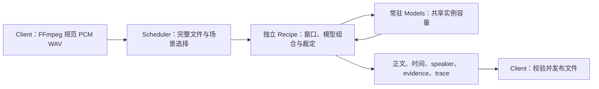

# ASR

## Scope

用独立 Scheduler 与 Models 镜像处理离线录音，覆盖朗读、双人混录、同步双人分轨与多人
会议。每场景选择一套或多套 Recipe，独立输出正文、时间、speaker、evidence 和 trace；
质量、组合与参数由真实音频确定，不从模型或方案名称推断排名。

Scheduler 拥有 API、Recipe、音频操作、HTTP 容量和 trace；Models 拥有模型环境、权重、
serving 与静态 s6；Client 拥有文件适配、轨道整理与发布。
[protocol.py](protocol.py) 拥有数据合同，[execution.py](execution.py) 只提供任务收敛与
文件线程生命周期，不包含算法。Host/GPU/mount/secret/network 属于部署输入。

## Contracts

- [Recipe](scheduler/scenarios/) 各自完整拥有切窗、组合、调用顺序、并发、复听、裁定、
  speaker 与句读，允许重复；不互调或读取对方定稿，不要求共同 prepare/first-pass/review。
  大文件只拆入本方案目录，不增加 pipeline 基类、hook、DAG DSL 或插件框架。
- 共用能力仅限音频操作、HTTP、数据结构、trace 与 execution。算法参数直接写在 Recipe；
  提示词、上游协议、输出解析与生成处理留在对应 serving。Scheduler 不导入部署模块，
  不启停模型；Models 不选择 Recipe。
- 新 Recipe 同步显式入口、场景默认列表、回归选择与 CLI 输出；省略列表执行场景全部候选，
  结果数量由选择决定。同一模型默认行为变化覆盖全部受影响 Recipe。
- 各层只等待真实依赖或容量；固定实例额度跨请求/Recipe 共享，不增加 GPU 级互斥。
  CPU 准备与在途文件数有界，Client 准备、上传、发布可重叠；同卡并发与 placement 以
  端到端耗时、吞吐和显存峰值验收，不用局部推理时间替代。
- TaskGroup/collect 收敛文件使用者；文件/推理线程通过 blocking 等待完成，不能只取消
  包装协程就释放文件或容量。失败/取消清理遵循根文档的任务所有权规则。
- Models 包含全部模型，各自独立 `.venv`/lock 和单一启动配置；ASR_MODELS 只选择已编译
  s6 服务及依赖。运行期不生成 graph、安装依赖或按请求装卸模型，uv 使用 frozen/no-sync。
- 引擎精度、TP、上下文固定在对应启动配置，副本复用配置，由容器分配 GPU/地址；场景
  差异用显式 endpoint/参数表达，不修改引擎全局状态或透传任意引擎配置。
- 选中模型只下载固定 revision，marker 命中复用；全部加载/预热完成后再推理，异常退出
  由 s6 supervision 重启。权重/cache 不入 image，构建期安装环境并 hardlink 去重，
  保留非 root 推理与部署 secret。
- 分轨输入须已同步，channel 0/1 固定 S01/S02；各轨独立识别，不运行 diarization，按
  时间/轨道排序并保留 overlap。双文件/多 stream 由 Client 按显式映射和起点整理；只有
  分轨场景赋予该身份，不猜测串音、身份或修正录制漂移。
- 模型时间相对输入，Recipe 映射回原始时间轴；local speaker 仅在本次调用有效。
  segment 包围 token 实际区间，缺失时间保留 null 并标记，不插值伪造。
- 结果用 scenario/recipe 标识，保留 revision、生效参数、raw evidence 与 trace；标点
  只能改变标点/空白，改字保留正文和 warning，截断正文不算成功。
- 正常路径是 ready 后提交完整文件，失败明确报错并人工重跑；不增加持久队列、替代模型、
  断点恢复或通用重试框架。固定准备/revision/参数不保证 GPU 逐位一致。

## Main Flows

先部署目标场景全部 Recipe 的模型并集，含条件复听；模型请求期间常驻，切换前等待当前
请求结束。Scheduler 可独立重建发布，不因此替换 Models 或重装模型环境。

Client 保留原始时间轴和所需声道，不提前混音、删静音或复制模型前处理。Scheduler/Models
以 multipart 传音频，各自管理临时文件，不共享请求目录。具体请求边界见
[scheduler/api.py](scheduler/api.py)，算法见对应 Recipe，不逐函数复述。

## Runtime I/O

本节主要描述独立的 [Client CLI](client/asr.py)，服务端只补充其联动边界。

- **Reads**：读取指定文件或目录中的录音，按显式 track/stream 参数整理输入；读取
  [trace template](client/trace.html) 生成报告，不修改原录音。
- **Writes**：在系统临时目录生成规范音频，在输出目标同级 staging 写结果；按输入相对
  路径发布独立目录，包含 JSON、Markdown、evidence 与 trace。目标已存在默认失败；
  `--overwrite` 会删除该目标目录，不仅覆盖同名结果文件。
  服务端请求文件放在容器 `/data/asr`，模型权重位于 `/model-data`，cache 保持各模型 run
  声明的路径；它们不是共享请求目录，也不随 Client 输出覆盖而删除。
- **Network**：向 `--server` 的 Scheduler 上传规范音频、文件名和识别选项；Scheduler
  按配置向 Models endpoint 发送音频与参数。Models 的 `download_model.sh` 从 Hugging Face
  下载固定 revision 权重，下载鉴权使用部署 secret；对应声明见 [models](models/)，
  挂载与 secret 输入由部署配置拥有。
- **Results & Failure**：所有选中 Recipe 完成且结果有效才算完整成功，部分失败仍保留
  结果与索引并返回失败。请求或生成失败先收敛文件任务再清理临时数据；输出替换并非整批
  事务，删除旧目标后的发布失败不保证恢复。服务端请求文件与持久权重/cache 分开，
  不因请求失败清空模型权重，也不修改 Host 系统配置。

## Pitfalls

- Scheduler health 只表示 API 可用，不能代替所选模型 health；提交前确认部署场景和依赖。
- memory utilization 不是显存硬上限，ready 占用不是运行峰值或 checkpoint 大小；`.venv`
  逻辑大小含重复 hardlink，不能累加为 image 物理占用。历史数据见
  [measurements.json](deployment/measurements.json)，当前参数以 run/serving/config 为准。

## Validation

Client 测试需要 FFmpeg。Recipe 变化验证真实场景；serving/HTTP/协议变化验证两端、CLI
与全部受影响 Recipe；输入适配验证格式、轨道和时间映射。s6 变化验证不同选择只启动目标
及依赖，支持的模式复用同一进程。

artifact/依赖变化构建对应 Dockerfile，检查 import、无权重与 hardlink 去重；协议或
execution 变化检查两个镜像。GPU 与真实音频验证使用 test-asr Skill，部署见
[Deployment](deployment/AGENTS.md)，语料与评分见 [Regression](regression/AGENTS.md)。
不停止其他任务，只清理本次验证容器；未运行的验证不得宣称通过。
