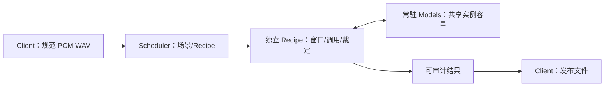

# ASR

## Scope

用独立 Scheduler/Models 镜像处理朗读、双人混录、同步双人分轨与会议录音；Recipe 独立
输出可审计结果，质量/组合/参数由真实音频确定，不从名称推断排名。Scheduler 拥有 API、
Recipe、音频操作、HTTP 容量与 trace，Models 拥有模型环境/权重/serving/s6，Client 拥有
文件适配/轨道整理/发布。[protocol.py](protocol.py) 拥有数据合同，
[execution.py](execution.py) 只提供任务收敛与文件线程生命周期，不包含算法。

## Contracts

- [Recipe](scheduler/scenarios/) 各自拥有切窗、模型组合、调用顺序、复听、裁定、speaker
  与句读，允许重复，不互调或读取对方定稿；共用能力只限音频、HTTP、数据、trace 与
  execution，不抽公共 pipeline 基类/hook/DAG DSL/插件框架，大文件只拆入本方案目录。
- 算法参数留在 Recipe，提示词/上游协议/解析/生成留在 serving；Scheduler 不导入部署
  模块或启停模型，Models 不选择 Recipe。新增方案同步登记、场景默认列表、回归与 CLI；
  省略列表执行全部候选，共用模型行为变化须覆盖全部受影响方案。
- 只等待真实依赖/容量，实例额度跨请求/Recipe 共享，不加 GPU 级互斥；CPU 准备与在途
  文件有界，Client 阶段可重叠。并发/placement 以端到端耗时、吞吐与显存峰值验收。
- Models 各自独立 `.venv`/lock/启动配置，ASR_MODELS 只选择预编译服务及依赖；运行期
  不生成 graph、安装依赖或按请求装卸模型，uv frozen/no-sync。引擎精度/TP/上下文固定，
  副本复用配置；场景差异用 endpoint/参数表达，不修改全局状态或透传任意引擎配置。
- 权重固定 revision，marker 命中复用，异常退出由 s6 supervision 重启；权重/cache 不入
  image，环境构建期安装并 hardlink 去重，保留非 root 推理与部署 secret。
- 分轨须已同步，channel 0/1 固定 S01/S02，各轨独立识别且不运行 diarization，保留 overlap。
  Client 只按显式 stream/轨道/起点映射，不猜测串音、身份或修正漂移；仅分轨场景赋予身份。
- 模型时间相对输入，Recipe 映射回原始时间轴，local speaker 仅在本次调用有效；segment
  包围 token 实际区间，缺失时间保留 null/标记，不插值伪造。标点只改标点/空白，改字保留
  正文与 warning，截断正文不算成功；结果保留 revision/参数/raw evidence/trace。
- 失败明确报错并人工重跑，不扩展持久队列、替代模型、断点恢复或通用重试框架；固定
  输入/revision/参数不保证 GPU 逐位一致。

## Main Flows

Client 保留时间轴/声道，不提前混音、删静音或复制模型前处理。Scheduler/Models 通过
multipart 传音频，不共享请求目录；请求与临时文件边界见 [scheduler/api.py](scheduler/api.py)。
部署前置条件见 [Deployment](deployment/AGENTS.md)；Scheduler 独立重建不替换 Models。

## Runtime I/O

- **Reads**：[Client](client/asr.py) 读取指定录音及显式轨道/stream 映射，不修改原录音。
- **Writes**：临时生成规范音频，在输出同级 staging 写结果并按输入路径发布目录；已有
  目标默认失败，`--overwrite` 删除整个对应目录。服务端请求文件在 `/data/asr`，权重在
  `/model-data`，cache 以各模型 run 为准，不因 Client 覆盖或请求失败删除权重/cache。
- **Network**：Client 向 `--server` 上传音频、文件名/选项；Scheduler 按配置向 Models
  发送音频/参数。Models 的 `download_model.sh` 从 Hugging Face 下载固定 revision，
  用部署 secret 鉴权，挂载/secret 输入由部署配置拥有。
- **Results & Failure**：选中 Recipe 全部完成且结果有效才成功，部分失败保留结果/索引
  并返回失败。文件/推理线程也须遵守根文档的收敛规则；输出不是整批事务，删除旧目录后
  发布失败不保证恢复。不修改 Host 系统配置。

## Pitfalls

Scheduler health 不代表模型 ready，提交前核对部署场景。memory utilization 不等于显存
硬上限，ready 占用不等于峰值/checkpoint 大小；`.venv` 逻辑大小含重复 hardlink，不能
累加为 image 物理占用。历史数据见 [measurements](deployment/measurements.json)，当前
参数以 run/serving/config 为准。

## Validation

Client 测试需要 FFmpeg；Recipe 变化验证真实场景，serving/HTTP/协议变化覆盖两端/CLI/
受影响方案，输入适配检查轨道/时间映射。s6 变化检查模型选择及依赖，同模型模式复用进程。
artifact/依赖变化构建受影响 image，检查 import/无权重/hardlink；协议/execution 变化
检查两个 image。GPU/真实音频使用 test-asr Skill，基线与评分见
[Regression](regression/AGENTS.md)；只清理本次容器，不停止其他任务。
