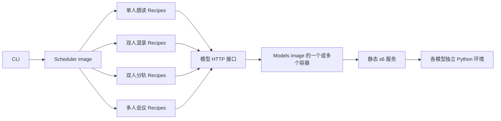

# ASR Design v2

本文描述已实现的 Scheduler / Models 架构与核心诉求。维护与验证入口见
[AGENTS.md](AGENTS.md)，真实语料与实测基线见 [regression/AGENTS.md](regression/AGENTS.md)。

## Core Requirements

### Functional

1. 面向本地离线录音，按实际场景维护多套针对性方案，模型选择与参数由真实音频实测确定。
2. 首批覆盖单人朗读、双人混录对话、双人分轨对话、多人会议。
3. 每个场景支持选择一套或多套 Recipe，分别输出正文、时间、speaker、evidence 与 trace。
4. 同一个模型通过不同接口或请求参数支持场景优化；模型与方案可以分别迭代和评测。
5. 双人分轨按轨道确定 speaker，保留原始时间轴与重叠讲话，并增加真实分轨录音回归。

### Implementation

1. 只构建两个镜像：Scheduler 和 Models；调度代码与模型部署独立发布。
2. Models 打包全部模型，各模型保留独立 Python 环境、一个启动配置和静态 s6 服务。
3. 环境变量选择容器启动哪些模型；同一镜像可部署为多个容器，模型按启动配置常驻。
4. 每个 Recipe 独立维护完整 pipeline，可读性优先；允许重复，不建立通用 pipeline 框架。
5. 默认尽可能并发，依赖满足且资源有余量就执行；并发容量通过实测固定。
6. 文件适配、轨道整理和结果发布放到 client，server 接收规范输入并专注推理编排。
7. 固定模型参数、处理规则和映射尽量直接写在所属代码中；一次性准备在运行前完成。
8. 按本地正常使用路径实现，以明确报错和人工重跑处理失败，保持运行机制简单。

## Architecture



| Owner | 职责 |
| --- | --- |
| Codespace / Podman | 容器、GPU 注入、mount、secret、网络与重启策略 |
| Scheduler | API、场景选择、Recipe 执行、音频切片、结果与调用记录 |
| Models | 权重准备、模型启动、推理接口、模型特有处理与 s6 supervision |
| CLI | 输入规范化、轨道整理、并发文件提交、结果展示与本地文件发布 |

Scheduler 使用 CPU 环境，通过配置中的固定模型地址调用 HTTP，不启动或停止模型。Models
不包含 Recipe，也不决定请求应该执行哪套方案。Scheduler 重建不影响常驻模型。

## Model Deployment

Models 镜像中，每个 `models/<model>/` 拥有依赖锁、独立 `.venv`、下载脚本、`run`
和必要的 Python serving。保留构建时环境去重，权重与运行 cache 持久化在镜像外。

容器启动选择示例：

```bash
ASR_MODELS=qwen3-asr-1.7b,qwen3-aligner
```

启动入口将模型名映射到已经存在的 s6 服务，只启动选中的服务及其下载依赖。s6 definition
在构建时固定，不按请求生成；运行时不安装依赖或装卸模型。选中的模型加载和预热完成后
才接受推理请求。

每个模型只维护一份引擎启动配置。精度、TP、上下文上限等固定在本模型 `run` 或 serving 中；
端口使用固定映射，GPU placement 由部署输入明确指定。增加同模型副本时复用相同启动配置，
通过另一个容器分配设备和地址。

同一个模型的不同场景共享已加载的实例。语言、热词、提示词、解码选项和输出方式通过本模型
支持的请求参数选择；不同操作可以使用独立 endpoint。请求处理不修改引擎全局配置。

## Recipe Isolation

每个 Recipe 是一个独立的异步入口，读本文件就能理解从音频输入到最终转写的完整流程。目录
按场景组织，实际 Recipe 入口以 `scheduler/scenarios/__init__.py` 为准；名称不表示质量排名：

```text
asr/
├── scheduler/
│   ├── Dockerfile
│   ├── api.py
│   ├── audio.py
│   ├── inference.py
│   ├── tracing.py
│   └── scenarios/
│       ├── narration/
│       │   ├── qwen.py
│       │   └── firered.py
│       ├── conversation/
│       │   ├── moss_joint.py
│       │   ├── qwen_pyannote.py
│       │   └── vibevoice.py
│       ├── conversation_tracks/
│       │   ├── qwen.py
│       │   └── firered.py
│       └── meeting/
│           ├── moss_joint.py
│           ├── qwen_nemotron.py
│           └── vibevoice.py
├── models/
│   ├── Dockerfile
│   ├── rootfs/
│   └── <model>/
│       ├── pyproject.toml / uv.lock
│       ├── download_model.sh
│       ├── run
│       └── service.py / api.py
├── protocol.py
├── client/
└── regression/
```

Recipe 独立拥有模型组合、切窗策略、调用顺序、并发、复听条件、文本裁定、speaker 处理及
最终句读。不同 Recipe 可以采用完全不同的前处理，不要求共同经过 prepare、first pass、
review 等阶段。

共享代码只承担边界清楚的基础操作：读取和裁剪音频、HTTP 调用、结果数据结构、trace 记录。
模型解码和原始响应解析留在对应 serving。场景算法放在 Recipe 内，需要拆文件时拆到该
Recipe 所属目录。

相似流程可以直接写两遍。Recipe 之间不互相调用、不读取对方定稿；不引入基类、继承 hook、
DAG DSL 或用一组开关控制所有场景的公共 pipeline。入口通过一张显式映射表注册。

这种隔离让单场景优化可以自由调整窗口、提示词、并行方式和模型组合，避免修改公共流程后
影响其他场景。代价是部分代码重复；质量收益仍通过该场景回归确认。

## Scenarios

| Scenario | 输入假设 | 主要优化方向 | 实现方案 |
| --- | --- | --- | --- |
| `narration` | 单人连续朗读 | 正文准确性、长上下文、句读与对齐；speaker 固定 | Qwen、FireRed 各自独立流程 |
| `conversation` | 双人混在同一条音轨 | 口语、轮次切换、speaker 与时间 | MOSS-TD joint、Qwen + Pyannote、VibeVoice |
| `conversation_tracks` | 两人各占一轨，轨道已同步 | 每轨独立识别、固定 speaker、重叠发言 | Qwen、FireRed 各自分轨流程 |
| `meeting` | 多人混录会议 | 远场漏识别、重叠讲话、跨窗 speaker 一致性 | MOSS-TD joint、Qwen + Nemotron、VibeVoice |

表中是当前独立候选。Qwen / FireRed 流程使用独立识别旁路、争议复听、标点与对齐；joint
流程使用模型自身正文与时间，并通过全文件 speaker anchor 统一窗口身份。质量与耗时见
真实回归基线；新增或调整模型组合继续以对应场景实测决定，不固定后续方案数量。

调用方明确指定场景。省略 Recipe 列表时执行该场景显式登记的全部候选，指定列表时
只执行所选方案。每份结果独立返回，默认列表由代码维护，评测后再调整。

### Model Composition

以下按当前 Recipe 实现列出模型职责。Qwen 指 `qwen3-asr-1.7b`，FireRed 指
`firered-llm`，SenseVoice 指 `sensevoice`，Paraformer 指 `paraformer`，Whisper 指
`whisper-large-v3`，MOSS-audio 指 `moss-audio`；MOSS-TD 与 MOSS-audio 是两个独立模型。
Recipe 名称表示主要方案，不是完整部署依赖清单。

| Recipe | 主识别 / joint 模型 | 首轮独立识别旁路 | 条件复听 | Speaker 来源 |
| --- | --- | --- | --- | --- |
| `narration/qwen` | Qwen | FireRed、SenseVoice、Paraformer | Qwen、FireRed、Whisper、MOSS-audio | 固定 S01 |
| `narration/firered` | FireRed | Qwen、SenseVoice、Paraformer | Qwen、FireRed、Whisper、MOSS-audio | 固定 S01 |
| `conversation/qwen_pyannote` | Qwen | FireRed、SenseVoice、Paraformer | Qwen、FireRed、Whisper、MOSS-audio | `pyannote-community-1` |
| `conversation/moss_joint` | `moss-td` | — | — | joint local speaker，经 `pyannote-community-1` 统一身份 |
| `conversation/vibevoice` | `vibevoice` | — | — | joint local speaker，经 `pyannote-community-1` 统一身份 |
| `conversation_tracks/qwen` | 每轨 Qwen | 每轨 FireRed、SenseVoice、Paraformer | 每轨 Qwen、FireRed、Whisper、MOSS-audio | channel 0/1 固定 S01/S02 |
| `conversation_tracks/firered` | 每轨 FireRed | 每轨 Qwen、SenseVoice、Paraformer | 每轨 Qwen、FireRed、Whisper、MOSS-audio | channel 0/1 固定 S01/S02 |
| `meeting/qwen_nemotron` | Qwen | FireRed、SenseVoice、Paraformer | Qwen、FireRed、Whisper、MOSS-audio | `nemotron-diarization` |
| `meeting/moss_joint` | `moss-td` | — | — | joint local speaker，经 `pyannote-community-1` 统一身份 |
| `meeting/vibevoice` | `vibevoice` | — | — | joint local speaker，经 `pyannote-community-1` 统一身份 |

辅助模型的调用范围：

| Model | 使用方案 | 作用 |
| --- | --- | --- |
| `firered-vad` | 全部 Recipe | 融合方案按语音区间切窗；joint 方案记录语音活动并检查输出是否覆盖有效尾部 |
| `firered-punc` | 六套 Qwen / FireRed 融合方案 | 对裁定后的正文加标点，保留正文内容 |
| `qwen3-aligner` | 六套 Qwen / FireRed 融合方案 | 对齐复听文本、裁回原窗口，以及最终正文的 token 时间 |

六套融合方案各自实现完整流程：VAD 后，Qwen、FireRed、SenseVoice、Paraformer 并发首轮
识别，以表中主模型正文作为裁定起点。有文本分歧且窗口不受多人混叠保护时，扩大上下文，
并发运行 Qwen、FireRed、Whisper 复听及 MOSS-audio 预先复听。前三者复听结果仍有分歧时，
才对齐并纳入 MOSS-audio 的文本；它的推理在此前已并发启动。复听结果对齐后裁回原窗口，
由本方案的确定性局部共识规则裁定，再执行标点与最终对齐。条件复听模型也是完整运行该
Recipe 的部署依赖；具体一次请求是否调用，以 evidence 为准。

四套 joint 方案并发启动 Pyannote anchor、VAD 与 MOSS-TD / VibeVoice 生成。正文、句段时间
和 local speaker 来自 joint 模型，Pyannote 用于跨窗身份映射；最终 speaker 活动区间来自
joint 句段。当前会议 joint 方案也使用 Pyannote anchor，Nemotron 仅用于
`meeting/qwen_nemotron`。joint 方案直接保留模型句读和句段时间。

部署某个 Recipe 时，`ASR_MODELS` 与 Scheduler endpoint 配置应覆盖该行和辅助表的模型
并集；同时运行多套 Recipe 时取全部依赖的并集。模型组合的 source of truth 是各自
`scheduler/scenarios/<scenario>/<recipe>.py`，调整组合时同步本节，并运行对应场景回归。

### Two-Track Conversation

规范输入采用同步双声道音频，channel 0 固定对应 `S01`，channel 1 固定对应 `S02`。这个
身份约定来自调用方选择分轨场景，不从“文件有两个声道”推断。来源若是两个文件或容器内
两个 audio stream，由 client 按明确的轨道映射和起点自动整理成该格式，保留静音及时间
偏移。日常输入整理属于 client 常规功能，回归语料的挑选与标注才是一次性准备。

每个分轨 Recipe 直接实现以下流程：

1. 提取两轨，保持共同时间原点，不做混音。
2. 各轨独立 VAD、识别及本方案需要的复听、标点和对齐。
3. 将轨道身份直接写入 segment 和 token，不运行 speaker diarization。
4. 将结果放回原始时间轴，按开始时间和轨道顺序排序，保留两人同时讲话的重叠区间。

两轨时长保持同步，不能分别删除静音后直接拼接。双轨场景采用“一轨主要对应一人”的输入
约定；自动处理串音、猜测轨道身份或校正录制时钟漂移不纳入首版。

## HTTP And Data

Client 负责识别源文件格式、用 FFmpeg 转成规范 PCM WAV，并整理明确指定的音轨。保留
场景需要的声道、采样信息及原始时间轴，不提前混音、删除静音或执行模型相关处理。Server
只接收规范音频和 JSON options，例如：

```json
{
  "scenario": "conversation_tracks",
  "recipes": ["qwen", "firered"],
  "hotwords": ["项目名", "产品名"]
}
```

Recipe 名称在场景内唯一，结果使用 `scenario/recipe` 标识。原始文件由 client 保留，Scheduler
保存本次上传的规范音频；Recipe 决定模型所需的采样转换、声道处理和切片。Scheduler 与模型
服务通过 HTTP multipart 传递音频，不依赖共享请求目录。

输入适配和本地产物操作优先放在 client，VAD、切窗策略、模型调用与融合留在 Recipe。
Client 不复制场景推理逻辑，Server 不增加任意文件格式和录音工具的适配分支。

每个模型进程监听固定内部端口，提供 `/health` 和自身操作接口，如 `/transcribe`、`/diarize`、
`/align`。相同能力采用一致的结果字段，模型专有参数由该模型显式校验。上游 vLLM 协议、
模型提示词和输出解析由模型目录内的 serving 封装，Scheduler 不加载模型部署代码。

场景模式可以是少量枚举参数或独立接口，直接在 serving 内实现明确分支；不建立可动态注册
的 Profile 系统。已验证的参数写入对应代码，不开放任意引擎参数透传。

模型返回文本、时间、speaker 及所需原始证据。时间相对本次输入音频，Recipe 负责映射回
原始录音；模型产生的 local speaker 只在本次调用内有效，分轨 Recipe 的身份来自轨道。
结果保留实际模型 revision 与生效参数，trace 记录阶段、模型调用和耗时。

Scheduler 和模型服务各自管理临时文件，推理使用结束后清理。CLI 发布各 Recipe 的
Markdown / JSON，以及 evidence 和 trace；输出数量由本次选择决定。

## Deterministic Implementation

固定配置就近维护，避免为少量明确规则增加配置系统：

| 内容 | 位置 |
| --- | --- |
| 场景、Recipe 入口和默认列表 | Scheduler 显式映射表 |
| 切窗、复听条件、模型组合与请求参数 | 对应 Recipe 代码 |
| 模型内部提示词、推理模式、响应解析 | 对应模型 serving |
| 引擎启动参数与权重 revision | 对应模型 `run`、下载脚本 |
| 容器启用模型、GPU placement 与 endpoint | 部署输入及 Scheduler 地址配置 |
| 日常文件适配与轨道整理 | Client 输入处理 |
| 回归音频、固定轨道映射与 reference | 固定 corpus 和 manifest |

依赖安装与 s6 graph 编译在镜像构建时完成。模型格式转换、回归语料挑选与标注等一次性工作
使用仓库外脚本完成，提交需要维护的声明和可校验产物。反复使用的 client 输入整理、下载、
启动和回归命令保留在仓库。

确定性指固定输入准备、模型 revision、参数和执行规则；GPU 推理是否逐位一致不作保证，
实际差异以回归结果为准。

## Local Execution

Scheduler 保持单进程异步运行，默认在依赖与资源容量允许的范围内尽可能并发：

- Client 的文件准备、上传和结果发布可以重叠，准备好的录音直接提交。
- 不同请求、同一请求的多个 Recipe，以及 Recipe 内独立的音轨、窗口和模型调用尽早启动。
- 只等待真实数据依赖或已满的资源额度；一个窗口完成后可推进后续处理，不等待无关窗口。
- 模型实例的并发额度跨所有请求和 Recipe 共享，由固定实例容量限制；实际引擎容量仍由
  serving 保证。CPU 准备与在途文件数也使用固定上限，避免一次将整批音频加载到内存。

静态 GPU placement、实例容量和同卡模型的并发安排通过实测确定，再写入固定配置或代码。
以整体完成时间和吞吐衡量并发收益，不以排队任务数量衡量。Recipe 独立维护不要求顺序执行，
也不需要引入 DAG 引擎或动态资源调度平台。

正常路径是模型 ready 后提交完整文件并等待结果。配置或推理失败直接报告位置和原因，用户
修正后重跑；不构建持久任务队列、断点恢复、自动替代模型或多级故障恢复。s6 继续管理模型
进程的退出与重启。

保留影响结果可信度和基本运行的检查：输入可解码、模型响应完整、时间范围合法、并发受限、
临时文件在使用结束后清理。标点模型改字时保留正文和原始 evidence，并显式标记拒绝改写。
截断正文不当作成功结果，缺失时间不通过插值伪造。模型确实需要
的生成处理在 serving 中明确实现，不增加通用重试框架。

## Regression And Delivery

沿用现有三类 corpus，新增 `conversation_tracks`，至少包含一条真实的双人独立分轨对话。
语料应覆盖交替发言、同时讲话和单方静音，固定音频 checksum、轨道身份及逐轨 reference。
已选用 AliMeeting R8009_M8021 两名参与者的独立头戴麦克风音轨，取前 20 分钟；
channel 0/1 固定为 S01/S02，reference 来自官方 TextGrid，评分不排列 speaker。
复制单声道到左右声道不能作为分轨质量回归。

双轨评分分别统计每轨 CER，并使用固定轨道身份检查 speaker 归属和时间轴，不能通过重新
排列 speaker 掩盖轨道交换。需要时可以用确定性拼接的小样本验证时间映射，但不代替真实音频。

每个场景按自己的 Recipe 列表运行回归，分别记录正文质量、适用的 speaker / 时间指标和
耗时。正式回归使用日常的并发执行路径，同时记录 client 准备、端到端完成和 server 推理
耗时；单独运行某个 Recipe 用于定位质量或性能变化，不作为强制串行的日常运行模式。
修改一套 Recipe 先运行本场景；修改模型 serving 或公共协议时运行所有受影响场景。

交付结构：

1. 拆出两个镜像，打通固定模型 HTTP 调用，通过统一模型接口执行独立方案。
2. 将各场景 Recipe 落成独立 pipeline，移除固定五方案的共同前置阶段。
3. 实现 client 输入整理和双人分轨流程，选定真实语料并加入回归、评分与 CLI 输出。
4. 完成两镜像的独立构建发布、部署示例和文档更新，删除旧单体运行路径。

实现交付执行 `task check:full`、两个镜像构建、环境变量选择模型的启动验证，以及受影响
场景的真实音频回归。验证 Scheduler 重建时模型仍常驻，同一模型可以连续处理不同模式的
请求；不要求为每个模式另启一个模型进程。
