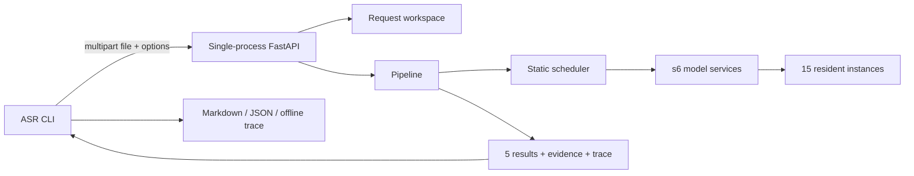
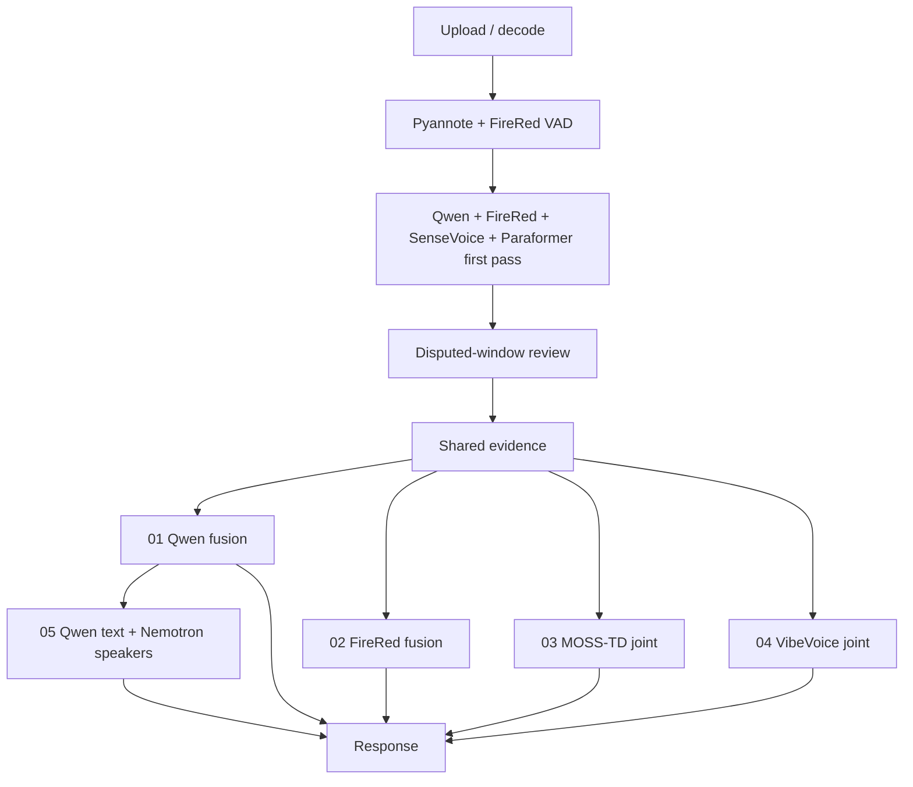

# ASR System Design

ASR Service 将一个普通话完整录音一次性转换为五份可比较的转写。它是 Host 级单例：一个公开
HTTP server 编排 15 个常驻模型实例，CLI 负责批量上传和发布人类可读产物。系统不提供实时流式
识别、任意模型组合、跨请求任务队列或运行期模型调度。

实现细节的 source of truth 见 [AGENTS.md](AGENTS.md)，质量与性能基线见
[regression/AGENTS.md](regression/AGENTS.md)。

## System Boundary



Server 拥有 HTTP 校验、临时文件、模型编排、五方案结果、共享 evidence 和原始 trace。CLI 拥有
目录遍历、文件级并发、Markdown、索引、离线可视化和原子发布。模型 service 只监听 loopback，
外部调用者不能绕过编排层。

每个 `models/<model>/` 是一个完整部署单元，包含锁定依赖、权重下载、运行环境、启动命令和
client adapter；需要自建 HTTP 服务的模型还在同目录拥有 endpoint 与推理实现。模型之间不共享
部署基类或启动模板，只通过顶层 `InferenceRequest` / `InferenceResult` 合同与 Scheduler 解耦。
具有实质 SSE 完整性和生成重试逻辑的 vLLM transport 由多个模型复用。

## Startup

1. s6 oneshot 检查每个固定 model revision；缺失时从 Hugging Face 下载到持久 model-data。
2. FastAPI lifespan 枚举容器可见 GPU，要求设备空闲并验证静态显存预算。
3. Scheduler 将逻辑 placement 映射为 GPU UUID，为每个实例写入端口与可见设备。
4. 一次 s6 transaction 并行启动全部模型，Server 并发等待 15 个 loopback health endpoint。
5. 只有全部实例 ready 后，公开 `/health` 才可用。

| 阶段 | Owner | 写入状态 | 失败语义 |
| --- | --- | --- | --- |
| 容器资源注入 | 控制面 / Podman | devices、mount、secret、shared memory | 缺少设备、目录或 secret 时容器不能完成启动 |
| GPU 映射 | `server/ops` | `/run/asr/<instance>/CUDA_VISIBLE_DEVICES` 与 `PORT` | 卡数、空闲显存或 placement 不满足即整体失败 |
| 权重准备 | s6 download oneshot | `/model-data/<model>` 与 `.revision` | 固定 snapshot 未就绪则对应模型不启动 |
| 模型驻留 | s6 model longrun | GPU / CPU memory 与 loopback listener | 任一模型 health 超时即回收已启动模型 |
| API ready | FastAPI lifespan | 无持久状态 | 只有全部模型 ready 后才接受请求 |

模型进程、权重和 compilation cache 都在请求前准备完毕。热启动可以复用 cache，但 readiness
合同不允许将 JIT、模型加载或 graph capture 推迟到首请求。

## Request Pipeline



prepare 先获得全文件 speaker activity，再与 VAD 取并集生成公共窗口。四路 first pass 使用同一
批窗口且互不交换结果。只有分歧、空结果或异常重复窗口进入 review；Qwen、FireRed、Whisper
与 MOSS-Audio 的批次在独立 lane 执行。01–04 从同一 evidence 出发并行完成，唯一跨方案依赖是
05 等待 01 后复制其正文和时间。

| 共享阶段 | 并发 / 复用 | 主要约束 |
| --- | --- | --- |
| upload / decode | 每请求一次；CPU semaphore | 原音写入请求临时目录，解码保留原始时间轴 |
| prepare | Pyannote 后 FireRedVAD | speaker 活动与 VAD 取并集；`--vad-off` 使用全文 |
| first pass | 四个模型批次并行；各模型逐窗串行 | 候选互不喂答案，使用相同短窗 |
| review | Qwen / FireRed / Whisper / MOSS-Audio 四批在独立 GPU lane 并行 | MOSS speculative 结果仅在三路主复听仍不一致时采用；同家族不增加独立票数 |
| response / publish | Server 返回一次 JSON；CLI 在临时目录生成全部文件 | 只有完整接收并写完后才替换目标目录 |

| Recipe | 独立正文来源 | 复用内容 | 本方案独有处理 | 最终 speaker / 时间 |
| --- | --- | --- | --- | --- |
| `01-qwen-fusion` | Qwen first-pass 短窗主稿 | 四路 candidates、全部 review、Pyannote speaker | 交叉证据裁定；FireRedPunc；Qwen Aligner | Pyannote speaker；重新对齐的字词时间 |
| `02-firered-fusion` | FireRed first-pass 短窗主稿 | 与 01 相同，但不读取 01 定稿 | 独立裁定；FireRedPunc；Qwen Aligner | Pyannote speaker；重新对齐的字词时间 |
| `03-moss-td` | MOSS-TD 长窗联合输出 | activity 尾部检查、Pyannote identity 映射、first-pass 争议标记 | 保留自身正文、时间和 local speaker；失败先去 padding，再按 exact core 安全二分 | local speaker 映射为全局身份；仅跨 core 的 segment 用 Aligner 裁剪 |
| `04-vibevoice` | VibeVoice 长窗联合输出 | 与 03 相同，但不读取 03 或融合稿 | 保留自身正文、时间和 local speaker；失败先去 padding，再按 exact core 安全二分 | local speaker 映射为全局身份；仅跨 core 的 segment 用 Aligner 裁剪 |
| `05-qwen-nemotron` | 完整复制 01 正文与字词时间 | 仅依赖已完成的 01；不重新 ASR | Nemotron 对全文件独立 diarization，仅重新切分 speaker | Nemotron speaker；正文和字词时间保持 01 不变 |

多人窗口不做融合替换。联合模型保留自身正文与时间，不拿融合稿修补。所有模型调用在请求内
single-flight，相同逻辑模型、音频切片和有效参数只推理一次。

## Model Roles

| 阶段 | 模型 |
| --- | --- |
| prepare | FireRed VAD、Pyannote Community-1 |
| first pass | Qwen3-ASR、FireRed LLM、SenseVoice、Paraformer |
| review | Qwen3-ASR、FireRed LLM、Whisper Large V3、MOSS-Audio |
| punctuation / alignment | FireRedPunc、Qwen3 Forced Aligner |
| joint recipes | MOSS Transcribe-Diarize、VibeVoice ASR |
| alternate diarization | Nemotron Diarization |

下面恢复面向维护者的汇总视图，便于一次看清完整部署。实际 source of truth 仍是
`models/catalog.py`、`server/server.yaml`、各模型 lock 与 `run`；修改这些实现时必须同步表格。

### Model Inventory

| 模型 | 端口 | 阶段 / 职责 | Serving | SDK / runtime | Python | Transformers | vLLM | Torch | CUDA | 部署 | 显存预算 / 卡 | Checkpoint | `.venv` 逻辑大小 |
| --- | ---: | --- | --- | --- | --- | --- | --- | --- | --- | --- | ---: | ---: | ---: |
| `firered-llm` | 8000 | first pass / review；第二主稿 | vLLM transcription | — | 3.12.14 | 5.17.0 | 0.31.0 | 2.13.0 | 13.0.3 | GPU 0+1，TP=2 | 32 GiB | 31.147 GiB | 7.392 GiB |
| `firered-punc` | 8001 | 01 / 02 标点校验 | 本模型 HTTP | FireRedASR2S 0.0.1 @ `4e7d9aa` | 3.12.14 | 5.1.0 | — | 2.10.0+cpu | — | CPU | — | 0.762 GiB | 0.832 GiB |
| `firered-vad` | 8002 | prepare 语音活动 | 本模型 HTTP | FireRedASR2S 0.0.1 @ `4e7d9aa` | 3.12.14 | 5.1.0 | — | 2.10.0+cpu | — | CPU | — | 0.002 GiB | 0.832 GiB |
| `moss-audio` | 8003 | review 残余争议复听 | vLLM audio chat | — | 3.12.14 | 5.17.0 | 0.31.0 | 2.13.0 | 13.0.3 | GPU 2 | 32 GiB | 16.862 GiB | 7.392 GiB |
| `moss-td` | 8004 | 03 联合正文、时间、speaker | vLLM transcription | — | 3.12.14 | 5.17.0 | 0.31.0 | 2.13.0 | 13.0.3 | GPU 3 | 48 GiB | 1.692 GiB | 7.396 GiB |
| `nemotron-diarization` | 8005 | 05 独立 speaker 重标 | 本模型 HTTP | NeMo 3.1.0+ca3f93a51 | 3.12.14 | 4.57.6 | — | 2.13.0 | 13.0.3 | GPU 1 | 12 GiB | 0.185 GiB | 5.288 GiB |
| `paraformer` | 8006 | first pass 中文旁路 | 本模型 HTTP | FunASR 1.4.16 | 3.12.14 | 4.57.6 | — | 2.13.0 | 13.0.3 | GPU 6 | 4 GiB | 0.820 GiB | 4.973 GiB |
| `pyannote-community-1` | 8007 | prepare 全文件身份 | 本模型 HTTP | pyannote.audio 4.0.7 | 3.12.14 | — | — | 2.13.0 | 13.0.3 | GPU 1 | 6 GiB | 0.031 GiB | 4.819 GiB |
| `qwen3-aligner` | 8008 / 8013 | review / finalize 字词时间 | pooling + 本模型 HTTP | — | 3.12.14 | 5.17.0 | 0.31.0 | 2.13.0 | 13.0.3 | GPU 6 / GPU 7 | 8 GiB | 1.709 GiB | 7.396 GiB |
| `qwen3-asr-1.7b` | 8009 | first pass / review；第一主稿 | vLLM transcription | — | 3.12.14 | 5.17.0 | 0.31.0 | 2.13.0 | 13.0.3 | GPU 4 | 12 GiB | 4.376 GiB | 7.392 GiB |
| `sensevoice` | 8010 | first pass 中文旁路 | 本模型 HTTP | FunASR 1.4.16 | 3.12.14 | 4.57.6 | — | 2.13.0 | 13.0.3 | GPU 5 | 4 GiB | 0.872 GiB | 4.973 GiB |
| `vibevoice` | 8011 / 8014 | 04 联合正文、时间、speaker | vLLM audio chat | — | 3.12.14 | 5.17.0 | 0.31.0 | 2.13.0 | 13.0.3 | GPU 5 / GPU 6 | 48 GiB | 15.517 GiB | 7.392 GiB |
| `whisper-large-v3` | 8012 | review 独立复听 | vLLM transcription | — | 3.12.14 | 5.17.0 | 0.31.0 | 2.13.0 | 13.0.3 | GPU 7 | 8 GiB | 2.875 GiB | 7.392 GiB |

Checkpoint 只统计固定 revision 的 serving weight；完整 allowlist 还包含 tokenizer、config、词典
和 CMVN。`.venv` 是逐目录逻辑大小，共享 hardlink 会被每行重复计数，不能相加代表 image 物理
占用。

### GPU Placement

| 逻辑 GPU | 常驻模型（显存预算 / 卡） | 合计预算 | 不同时推理的关键边界 |
| ---: | --- | ---: | --- |
| 0 | `firered-llm` 32 GiB（TP rank） | 32 GiB | FireRed TP rank 独占计算 |
| 1 | `firered-llm` 32 GiB、`pyannote-community-1` 6 GiB、`nemotron-diarization` 12 GiB | 50 GiB | Pyannote / Nemotron 不与同请求的 FireRed 同时推理 |
| 2 | `moss-audio` 32 GiB | 32 GiB | 独立 review lane |
| 3 | `moss-td` 48 GiB | 48 GiB | 独立 03 lane |
| 4 | `qwen3-asr-1.7b` 12 GiB | 12 GiB | 独立 first pass / review lane |
| 5 | `sensevoice` 4 GiB、`vibevoice-a` 48 GiB | 52 GiB | SenseVoice 在 first pass；A 副本执行 04 长窗 |
| 6 | `paraformer` 4 GiB、`vibevoice-b` 48 GiB、`qwen3-aligner-review` 8 GiB | 60 GiB | Paraformer 在 first pass；Aligner 与 04 overflow 按 phase 错开 |
| 7 | `whisper-large-v3` 8 GiB、`qwen3-aligner-recipe` 8 GiB | 16 GiB | Whisper review 结束后进入 recipe finalize |

静态 placement 按 phase 隔离 critical path；低平均 GPU utilization 本身不是缺陷，强制均衡可能
让长模型与另一请求的 first pass 争用同卡。

## HTTP Contract

- `GET /health`：仅在全部模型 ready 后返回 `{"status":"ready"}`。
- `POST /transcribe`：multipart `file` 加 JSON 字符串 `options`，返回 `results`、`evidence`、
  `trace`。
- options、模型响应、时间边界和结构均由 Pydantic 校验。空文件和非法输入返回 422。
- 某个 recipe 失败可返回 partial；decode 或公共 prepare 失败使整个请求失败。
- 请求 workspace 位于 `/data/asr` 的临时目录，响应完成或异常后删除。

模型内部 transport 分两类：标准 SDK 服务接收 JSON `InferenceRequest`；自定义 vLLM / chat
服务使用各自固定协议。vLLM SSE 只有完整收到 `[DONE]` 且正常 stop 才可作为证据。

## Persistence And Security

| Host / runtime source | Container path | Mode | 生命周期与内容 |
| --- | --- | --- | --- |
| `${RESOURCE_DATA}/models` | `/model-data` | 正常部署 rw；预下载测试可 ro | 13 个固定 snapshot、HF metadata 与 `.revision`；跨 image / container 保留 |
| `${RESOURCE_DATA}/requests` | `/data/asr` | rw，UID/GID `5230:5230` 可写 | 上传、解码和切片；请求结束清理 |
| `${RESOURCE_DATA}/cache` | `/home/x/.cache` | rw，UID/GID `5230:5230` 可写 | vLLM、TorchInductor、CUDA、Triton、FlashInfer 与 Torch extension cache；跨启动保留 |
| Podman secret `huggingface_token` | `/run/secrets/huggingface_token` | ro，x 可读 | 仅 marker 缺失或 revision 改变时读取 |
| Podman private shared memory | `/dev/shm` | rw，8 GiB | FireRed TP / NCCL IPC；不持久化 |
| 容器 writable layer | `/run/asr` | rw | scheduler 生成的端口与 GPU UUID；容器替换即消失 |
| CLI 所在机器的 `--out` | 不挂入容器 | client-owned | 最终 14 个文件；Server 不拥有用户结果目录 |

模型权重不进入 image。Hugging Face token 只通过 Podman secret 注入，并且仅在 marker 缺失或
revision 改变时读取。服务使用固定非 root 用户运行；公开 API 不接受 Host 路径。

## Image Footprint

下表是当前 image 组成的量级视图；精确值以完成构建后的 `podman image inspect` 与
`podman history --human=false` 为准。模型权重全部外置，不计入 image。

| Layer 类别 | 大小 | 占 image | 内容 |
| --- | ---: | ---: | --- |
| Python 与全部 uv 环境 | 约 10.65 GB | 约 86.1% | Server + 13 个隔离 `.venv`；uv cache 清理并做 hardlink 去重 |
| 系统软件与 uv | 约 851 MB | 约 6.9% | FFmpeg、libsndfile、compiler、git、sudo、uv |
| CUDA 13 compiler toolkit | 约 393 MB | 约 3.2% | nvcc、headers、NVVM、runtime linker inputs 与 driver stub |
| CUDA forward-compat libraries | 约 322 MB | 约 2.6% | H100 / R535 使用的 CUDA 13 userspace compatibility package |
| `service-s6` base | 约 154 MB | 约 1.2% | Debian、s6、基础工具与固定用户 |
| ASR 代码、配置与 s6 graph | 约 4 MB | <0.1% | Server、models、ops、client、文档和 service definitions |

当前正式 image 未压缩大小约 12.37 GB。修改 lock、toolkit、安装或 hardlink 流程后必须重新测量；
不能用逐模型 `.venv` 逻辑大小之和推断 image 物理占用。

## Output Contract

```text
<out>/<recording>/
├── 01-qwen-fusion.md / .json
├── 02-firered-fusion.md / .json
├── 03-moss-td.md / .json
├── 04-vibevoice.md / .json
├── 05-qwen-nemotron.md / .json
├── index.md
├── evidence.json
├── trace.json
└── trace.html
```

`evidence.json` 保存一次模型原始响应、候选、复听依据与实际参数；recipe JSON 通过引用使用它。
`trace.json` 是 phase、调用、排队、cache 与 GPU 原始采样的唯一工程追踪数据，不复制正文。
`trace.html` 由 CLI 生成且无外部依赖，可离线查看流程、时间线、火焰图和 GPU 曲线。

```bash
uv run platform/container/services/asr/client/asr.py ./recordings \
  --server http://asr-host:8080 \
  --out ./texts \
  --parallel 2
```
